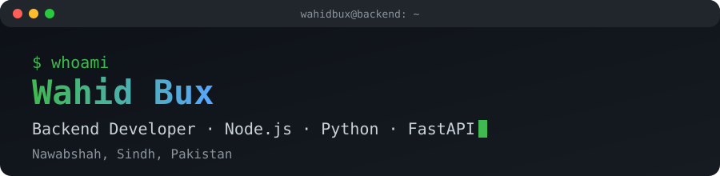

<p align="center">
  
</p>

<p align="center">
  <a href="https://www.linkedin.com/in/wahid-mari-0671b9379/"></a>
  <a href="mailto:wahidmari2004@gmail.com"></a>
  
  
</p>

## 🟢 `cat about-me.yaml`

```yaml
apiVersion: humans.dev/v1
kind: Developer
metadata:
  name: wahid-bux
  location: Nawabshah, Sindh, Pakistan
  labels:
    role: backend-developer
    open-to: collaboration
spec:
  currentlyWorkingOn:
    - Building REST APIs with Node.js and Express
    - Structuring clean, scalable backend projects
  learning:
    - Advanced JavaScript and system design
    - Authentication, security and deployment
  lookingToCollaborateOn:
    - Open-source backend projects
    - Full-stack web apps
  askMeAbout:
    - Node.js, Express, MongoDB, SQL
status:
  phase: Running
  conditions:
    - type: Learning
      status: "True"
    - type: OpenToCollab
      status: "True"
```

## 🧰 Tech Stack

**BACKEND · DATABASES**


**FRONTEND · LANGUAGES**


**TOOLS**


## 🚀 Featured Projects

| Project | Description | Stack |
| ------- | ----------- | ----- |
| [nodejs-structure](https://github.com/wahidbux/nodejs-structure) | A clean, organized folder structure for Node.js backends | `Node.js` `JavaScript` |
| [crud_application](https://github.com/wahidbux/crud_application) | A CRUD app with server-rendered views | `Express` `EJS` |
| [nodejs-basics](https://github.com/wahidbux/nodejs-basics) | Core Node.js concepts, step by step | `Node.js` |
| [advance-javascript](https://github.com/wahidbux/advance-javascript) | Advanced JavaScript concepts and practice | `JavaScript` |

> ✏️ Replace or add your best projects here. A short description and the tech used for each makes a big difference.

## 📊 GitHub Stats

<p align="center">
  
  
</p>

<p align="center">
  
</p>

<p align="center">
  
</p>

## 🤝 Let's Connect

I'm always happy to talk about backend development, learn from others and work on open source. Reach out on LinkedIn or by email.

```bash
$ node status.js
Server running... thanks for stopping by! ✔
```
